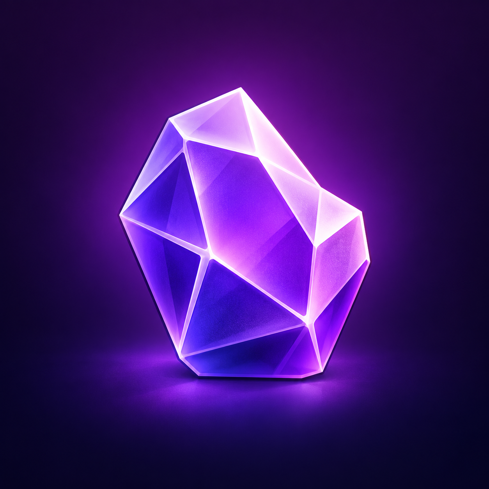

# GlassEmu

GlassEmu is an eye-candy edit of melonDS Android, made for my personal taste. It refreshes the frontend and emulator skins while using the melonDS emulation core.

Supports Android, with the layout tailored to the Samsung Galaxy A36.

## Screenshots

## Credits

- [melonDS](https://melonds.kuribo64.net/) for the emulator core.
- [melonDS Android](https://github.com/rafaelvcaetano/melonDS-android) for the Android port this project is built on.
- [Ant](https://deltastyles.com/user/1816-Ant) for [Ultimate DSi Skins (For Delta)](https://deltastyles.com/skins/599-ultimate-dsi-skins-for-delta), which we modified for GlassEmu.
